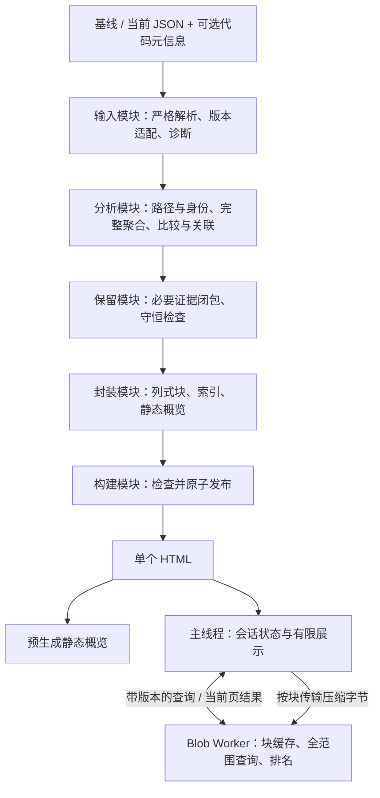

# Cmetrics 离线对比报告架构设计

- 版本：v1.0，面向 [PRD v1.2](PRD.md) 的架构设计稿。
- 状态：根据已确认需求及原型证据选定待验证路线；P1–P3 补验通过后确认产品化架构。本文描述目标设计，不表示正式实现或 P1–P4 验收已完成。
- 交付形态：Python CLI 读取一组基线／当前扫描 JSON，生成一个自包含 HTML；阅读时通过桌面 Chrome / Edge 的真实 `file://` 运行。
- 范围：输入适配、可信比较、聚合与关联、数据保留、报告格式、浏览器查询、页面状态、失败处理及验证计划。

## 1. 设计依据与证据边界

产品行为以 [PRD](PRD.md) 为准，术语沿用 [GLOSSARY.md](../GLOSSARY.md)。[模拟数据生成指导](mock-data-generation.md)与 [Schema](../schemas/cmetrics-report.schema.json)只定义模拟 profile；[FSR](FSR.md)提供历史方案依据。发生冲突时，不继承 FSR 中已被 PRD 覆盖的“待评审”、抑制告警或待确认描述。

| 依据 | 本设计采用的结论 | 不能据此宣称的能力 |
|---|---|---|
| [UI 原型当前决策](../.scratch/report-ui-prototype/spec.md)及第 2–11 轮记录 | 概览、三栏分析、全部指标；两组各 10 项；12 项均值／比例的单一净影响；任务式查询与返回上下文 | 原型只在每侧 181 文件、545 普通函数的合成数据上验证，不能证明正式输入适配和满规模性能 |
| [容量原型记录](../.scratch/report-large-data/issues/01-capacity-validation.md) | 紧凑列、字典编码、gzip/base64、Blob Worker、有限显示具有目标量级可行性证据 | 未证明完整业务、跨浏览器、全部分页、全部字段搜索或正式内存门槛通过 |
| PRD §9.1.1 对容量记录的修正 | 三套每侧 10 万文件／100 万函数数据的 HTML 为 13.69–13.79 MiB；历史构建 19.6–20.8 s、RSS 2.21–2.83 GiB；限定环境下记录了亚秒启动和首页热查询 | 构建未包含正式完整管线；26 项检查不是 33 项汇总全核验；1,433 MB 浏览器 RSS 不是干净会话内存增量；历史逐次样本不足以独立复算 P95 |
| PRD §13.3 D-01–D-03 | 20 项展示不增加评审义务；“全部对象”指全部保留对象；净影响固定先分子、后分母 | 不增加全部原始未变化明细可查、自动归因或评审流程 |

容量原型的普通列表第 51 页以后、片段分页键、函数／危险函数名称搜索及过期响应处理已有静态发现，必须在正式接口下修正并补验。原型 issue 的 `resolved` 只表示该轮记录完成。

## 2. 架构决策

| 决策 | 采用方案及原因 | 取舍与验证要求 |
|---|---|---|
| 计算分工 | Python 完成适配、校验、跨侧匹配、各侧完整聚合、关联及保留判定；浏览器查询已编译结果 | 浏览器不再解释原始扫描 JSON，不在点击时重新匹配百万函数 |
| 生成端技术 | Python 3.12+、`uv`；`msgspec` 表达内部契约，Polars 处理列式聚合与匹配；Jinja2 生成 HTML；标准库负责严格 JSON 读入、压缩及文件发布 | 沿用现有依赖。JSON 重复键检查不能由 `msgspec` 类型解码替代；模拟 Schema 校验继续使用 `jsonschema` |
| 页面技术 | 原生 JavaScript、CSS、HTML 与轻量 SVG 条形图；源码按职责拆分，构建时合并成内嵌 classic script | 三页和有限表格不引入前端框架、通用图表库或运行时模块加载；复杂度集中在状态和查询接口 |
| 浏览器计算 | 一个 Blob classic Worker 负责解压、查询、排序及净影响排名；主线程负责状态和有限 DOM | 原型已有 `file://` 证据；单 Worker 控制数据副本，长任务通过分块调度与取消降低积压 |
| 报告数据 | 版本化 manifest、小型概览、分块字典、列式表、关系索引；数据块独立 gzip 后 base64 内嵌 | 以列类型、长度、校验信息和依赖约束格式；不直接固化原型的数组位置和本机字节序 |
| 查询与分页 | 全声明范围过滤、精确计数、稳定排序，再取页；缓存紧凑命中行 ID | 不采用原型固定前 50 页的候选截断；首页、深页、末页使用同一结果集 |
| 数据保留 | 完整分析后计算必要证据的保留闭包；仅省略独立且不影响任何指标或证据的未变化明细 | 保留聚合贡献、导航、异常和省略数量。全量变化时允许无省略收益 |
| 首屏与失败 | Python 预生成静态概览；交互初始化成功后启用查询；失败保留可读内容和明确错误 | 静态可读不计作“概览可操作”或交互验收通过 |
| 发布 | 同目录临时产物，完整检查通过后原子发布 | 失败／取消不留下可误认为成功报告的半成品；受限报告须明确标识 |

首期不采用 Arquero、DuckDB-Wasm、OPFS、浏览器数据库、Service Worker 或本地服务。现有证据尚不要求增加这些依赖；若当前方案不能满足硬门槛，重新评审后再变更。它们不是自动启用的降级路径。

第三方版本以仓库 `uv.lock` 和正式构建记录为准，发布时登记直接及传递依赖的许可证。本文不以 `pyproject.toml` 的最低版本表达实际测试版本。浏览器无需下载库、字体、扩展或 WASM。

## 3. 系统结构与职责



模块按需要隐藏的复杂度划分，不按 13 张历史结果表拆成 13 套流程。文件、函数的身份记录分别共享给相关指标；重复组只维护扫描内关系。模块接口同时规定值、状态、失败、范围和资源责任。

| 模块 | 对外接口，名称为目标设计 | 隐藏的实现与不变量 |
|---|---|---|
| 构建 `build` | `build_report(BuildRequest) -> BuildResult` | 阶段编排、资源释放、诊断汇集、文件发布；唯一拥有整个生成任务生命周期的模块 |
| 输入 `ingest` | `load_scan(source, profile) -> ScanResult` | 严格解析、显式字段映射、侧内路径与引用校验；返回有效数据、完整性和诊断，不以空集合吞掉错误 |
| 分析 `analysis` | `analyze_pair(baseline, current, catalog) -> AnalysisResult` | 可比性、键基数、两侧聚合、比较、超限、关系；裁剪前完成所有依赖完整数据的计算 |
| 保留 `retention` | `select_records(analysis) -> RetainedReport` | 保留原因、关联闭包、省略账本；保证必要证据可达和统计守恒 |
| 封装 `packaging` | `compile_report(retained) -> ReportBundle` | 稳定 ID、列类型、块索引、压缩、静态模型；结果可逐块迭代，不要求一个巨大内存字符串 |
| 浏览器存储 `store` | `open(manifest)`、`readBlock(blockId)` | 长度与格式检查、解压、TypedArray 视图和按字节计费的缓存；不理解业务筛选 |
| 浏览器查询 `query` | `execute(QueryRequest) -> QueryResult` | 完整范围过滤排序、数量、分页、排名和证据读取；不依赖 DOM |
| 页面 `state / views` | `dispatch(action)`、`render(state, result)` | 会话状态转换、响应校验、三页布局与定位复制；不自行补零或推断匹配 |

输入版本确实会变化，适配器是明确的替换位置：模拟 profile 与经内部核验的真实 profile 使用同一规范化结果契约。未证实的真实版本不注册为支持版本。其余模块暂不建立插件、数据库或查询引擎的通用替换框架。

拟新增目录如下；这是实施结构，不表示文件已存在：

```text
src/cmetrics_cmp_viz/
├── cli.py                         # 保留 generate / validate，新增 report
├── schema.py / generator.py / validator.py  # 现有模拟工具
└── report/
    ├── build.py
    ├── model.py                   # 扫描、分析、诊断与构建契约
    ├── metrics.py                 # 指标定义与数值策略
    ├── ingest.py
    ├── profiles/                  # 模拟及已核验版本的显式映射
    ├── analysis.py
    ├── retention.py
    ├── packaging.py
    └── assets/
        ├── report.html / report.css
        ├── bootstrap.js / state.js / views.js
        └── worker.js / store.js / query.js / numbers.js
```

原型的 `prototypes/ui/`、`prototypes/performance/` 和 `scripts/prototype_scale_data.py` 保留为验证参照。正式入口不导入原型数据生成器，也不依赖压力数据 manifest。资产、profile、指标名称和 Schema 须作为包资源进入 wheel，通过包资源接口读取，安装后不依赖源码仓库的相对位置。

## 4. 内部数据契约

### 4.1 三层模型与身份

原始扫描结构、规范化分析模型、浏览器物理格式分别定义。原始字段拼写和数组位置只出现在输入模块；列偏移和压缩方式只出现在封装／存储模块。

| 记录 | 关键内容与身份规则 |
|---|---|
| `ScanMetadata` | 扫描侧、profile、工具版本、语言、阈值、声明路径集合及公共根、输入摘要；用户提供的仓库／分支／节点／版本另列来源 |
| `FileRecord` | 规范化相对路径、三项文件度量、类型、有效性；`file_sizes[path]` 依次映射为非空非注释代码行、物理总行、文件有效重复行。可靠映射下以相对路径匹配，不追踪移动或重命名 |
| `MethodRecord` | 所属文件、原始名称、代码行、圈复杂度、起止行；侧内记录 ID 与跨侧匹配键分开 |
| `MatchRecord` | 两侧记录引用或歧义集合引用、匹配方式、两侧键基数、可用比较能力；普通函数代码行和圈复杂度共享匹配 |
| `DirectoryRecord` | 父目录、直接成员、后代范围、各侧完整聚合、覆盖数量；超大目录扫描原值与恢复成员数分列 |
| `Group / Fragment` | `(side, groupKind, groupId)` 限定组身份；片段保留文件、起始行及有效长度，不推导物理末行 |
| `PositionRecord` | 危险函数为文件／名称／行号；冗余块保留原始条目及重数，内部条目 ID 不宣称稳定业务身份 |
| `MetricResult` | 两侧原值、明细派生值、差值、方向、分子分母、单位、可比性、来源及诊断引用 |
| `Diagnostic` | 稳定错误码、严重性、扫描侧、字段／对象引用、原因、受影响指标／范围、被禁止的结论 |
| `RetentionLedger` | 原始有效数、异常数、保留数、省略数及原因；按侧、实体类型和目录范围记录可核对的贡献 |

内部 ID 为报告内标识，不等于扫描器稳定 ID。按规范化键和明确的决胜字段确定排序后分配，使重复构建语义稳定。根映射失效时，文件／目录 ID 留在各自扫描命名空间，不制造跨侧配对。

### 4.2 值与状态

物理存储可以使用枚举列、位图和诊断引用，逻辑上必须保留以下独立维度：

| 维度 | 状态及用途 |
|---|---|
| 对象存在性 | 已观测、不在扫描集合、未知；“不在扫描集合”必须有完整性证据 |
| 值有效性 | 已知、未知、无效、不适用；无效数值不能进入确定性聚合 |
| 问题／超限成员状态 | 存在、不存在、未知；对象存在但无问题或未超限不等于对象不存在 |
| 匹配 | 可靠一一匹配、可靠单侧、匹配歧义、因映射限制停用 |
| 可比性 | 已验证、不可直接比较、未验证；附版本、规则、阈值或范围原因 |
| 来源 | 输入观测、完整明细派生、明确零基准、用户提供；原值与推导值不能混同 |

只有指标规则允许、相关集合完整且缺项已证实时，才为可加总量建立零基准。禁止统一使用 `value ?? 0`。超限退出优先从完整文件／函数明细取实际值；超大目录另一侧未申报原值时，保留其未知状态及独立的恢复成员数。

`canObserveDelta`、`canCompareObjects`、`canExplainImpact` 等能力由分析模块根据上述状态计算，页面只消费能力和原因。不可比数据可能仍有有意义的观测差值，但不进入确定变化结论或净影响排名。异常不能归入“无变化”。函数匹配歧义只屏蔽无法证明的逐函数差值；在文件身份、函数覆盖和数值均可靠时，两侧完整函数聚合仍可使用。

### 4.3 指标目录与精度

`MetricCatalog` 是指标名称、分组、顺序、单位、公式依赖、对象类型、阈值键、可用筛选及零基准规则的唯一机器定义。中文名称对齐 [metric_names.md](metric_names.md)，实际白名单和页面顺序以 PRD §5.1 为准。加载名称表时校验键集合；历史拼写问题显式修正或映射，不用模糊匹配自动扩展指标。

构建时由同一目录产生静态概览、交互导航和全部指标模型：20 项页面指标，13 项计算过程汇总，另加 `maximum_nbnc_loc` 共 14 项折叠过程数据；33 项汇总没有增加字段。五类超大指标的数量与比例共享阈值及对象集合。两项 `warning_suppression_*` 兼容读取但不进入分析、统计或零值补齐。

数值规则如下：

- 数量和总量在生成端按整数计算，检查列式运算的溢出；均值／比例保留原始整数分子分母，输入十进制原值保留其精度。不得先将比值舍入再比较。
- 与模拟汇总核对时，按已确认的十进制 Half-Up、最多 6 位小数规则；真实 profile 使用已核验精度策略。允许的序列化舍入差与真实汇总冲突必须分开。
- 展示默认 Half-Up 到 2 位，均值／比例／密度保留尾零，计数显示整数和千位分隔。共享 `numbers` 契约，禁止依靠 `Math.round` 或二进制浮点的偶然结果解释十进制边界。
- 方向、筛选和排序使用精确值或其等价排序键；接近零的非零变化保留方向并可展开更高精度。比例差单位为百分点。
- 零分母在报告中为“不适用”，不输出确定差值或净影响。模拟输入的原始 `0` 仍可在来源中查看；`code_size < 1000 → 0` 只适用于 `redundant_code_kloc`。
- 浏览器常见安全整数可使用 `Number`；超出安全整数或乘积范围时使用精确整数表示／`BigInt`。大整数、十进制及有理数不能无声转成 `Number`。Python 与 JavaScript 以共享夹具核对结果。

## 5. 生成管线

### 5.1 CLI 与构建结果

正式 CLI 增加 `report` 子命令，既有 `generate`／`validate` 含义不变。下列为待实现接口：

```bash
uv run python -m cmetrics_cmp_viz.cli report \
  --baseline baseline.json \
  --current current.json \
  --output comparison.html \
  --baseline-node abc123 \
  --current-node def456
```

必填参数为 `--baseline`、`--current`、`--output`。两侧各有可选的 `--baseline-repository`／`--current-repository`、`branch`、`node`、`version` 参数，全部标为“用户提供、未验证”；未填不从文件名推断。profile 默认按注册的工具版本及结构识别，无法唯一识别时可用 `--baseline-profile`／`--current-profile` 指定已注册 profile，但不能绕过其适用条件。

输出已存在时默认拒绝覆盖；显式 `--force` 才替换。禁止输出覆盖任一输入。输入中的扫描命令及源码路径只作为数据处理，不执行命令、不访问对应源码文件系统。

| 结果 | CLI 退出码 | 发布行为 |
|---|---:|---|
| 正常报告 | 0 | 发布一个 HTML，显示输出位置和阶段统计 |
| 受限报告 | 3 | 发布带全局警示和局部限制的 HTML，输出限制原因；该退出码不表示未生成文件 |
| 全局阻断／构建或 I/O 失败 | 1 | 不发布新报告，提供可定位诊断 |
| 参数错误 | 2 | 不开始分析 |
| 用户中断 | 130 | 清理本次临时产物，不替换既有报告 |

阶段日志写标准错误，至少覆盖读入、适配／校验、分析、保留、封装、发布。`BuildResult` 返回状态、输出路径、诊断计数及阶段耗时；完整诊断进入有效报告，阻断时在 CLI 给出扫描侧和字段／对象位置。

### 5.2 严格读入、适配与校验

1. 顺序处理两侧输入并计算 SHA-256 摘要。L0 使用能发现重复对象键的解析路径，非整数 JSON 数值直接解析为十进制表示，拒绝非法 UTF-8、非标准常量及不可表示的数值；保留缺失、`null`、空容器的差异。不能先普通解码、丢掉重复键或十进制精度后再声称检查通过。
2. 按 profile 校验顶层及字段结构，显式映射名称、类型、单位与比例尺度。模拟 profile 严格执行现有 Schema；真实 profile 分别登记必填、可空、未知字段策略和语义证据。
3. 校验每侧命令、路径、引用、函数末尾对象、数值关系和可证明的汇总。最大值对象唯一且在末位，并与实际函数最大值核对；不把最后一条无条件删掉。无函数时仍保留双零末尾对象。
4. 转换为列式批次与诊断，释放不再需要的原始对象；完成基线规范化后再读当前。避免两份原始字节、字符串、完整 Python 对象和多份 DataFrame 同时存活。
5. 将异常映射到明确影响范围。局部结构损坏可隔离时保留其他数据；无法确定影响范围的错误升级为全局阻断。不能把现有严格验证器的错误列表简单改成“忽略错误继续”。

`validate` 仍是模拟数据 L0–L3 严格验证入口。报告管线复用经过检查的数值、路径和校验规则，并增加结构化诊断及局部隔离能力。L3 只用于合成内部模型；外部输入不报告“重复有效覆盖并集已验证”。首版按单侧解析、批次转换实现；完整管线若超过生成预算，须在保留同等检查的前提下引入有实测依据的流式／临时列式存储，不得跳过校验。

### 5.3 路径映射、身份与记录比较

命令使用限定语法解析：恰一个 `-fp`，值为逗号分隔绝对 POSIX 目录，包含 `-l clike`。拒绝 PRD §6.1 的不支持形式。公共根按路径段计算，逐项确认明细位于某个声明扫描目录之下；不盲目小写、不使用字符公共前缀、不解析符号链接。

单侧无法建立可靠路径命名空间、根外路径或碰撞无法隔离时全局阻断。两侧各自有效但公共根层级不一致、相对命名空间无法对齐时，按 PRD 生成受限报告：顶部显示“扫描根路径不一致，文件级对比已降级”，停止文件／函数及依赖这些身份的跨侧比较，保留各侧自身聚合和原始记录。禁止自动删除路径前缀或将结构平移显示为全量集合进出。扫描范围比较使用规范化范围定义；不同检出根的命令文本不同本身不是不可比证据，文件集合变化也不等于扫描范围定义变化。

匹配先统计键基数，再执行连接：

- 文件使用可靠相对路径；函数优先使用经核验的稳定身份，否则用 `(fileId, methodName)`。只有两侧均唯一的共有键配对；一侧唯一、另一侧经完整性证明不存在时形成单侧记录。任一侧基数大于 1，整组保留为匹配歧义，不按行号强配，不产生全排列。
- 危险函数先对 `(fileId, name, line)` 去重，再比较记录集合；不同名称同一行不合并。
- 冗余块按原始条目保留重数。相同行号重复时用多重集合比较其数量，不套用危险函数去重，也不声称识别了块的稳定身份。
- 重复文件数量按组成员路径并集计算。重复组的侧内编号只用于本侧导航，两侧独立选择；组编号改变不产生跨版本组匹配。
- 位置、关联和其他度量变化分别记录。当前数值相同可显示“无变化”，但这些标记仍参与必要证据保留。

### 5.4 完整聚合、超限与净影响

目录树从完整文件集合恢复，预计算父子关系、直接成员及后代区间。有文件时公共根计入一次，空扫描的目录数为零，不补磁盘空目录。文件代码行／重复行、函数代码行／圈复杂度先按侧聚合，再比较；同时保存有效数、异常数和内部增长／减少对象数，目录净零仍可下钻。未知贡献不并入已验证总量，部分聚合须带覆盖说明。

文件／函数四类超限按各侧生效阈值严格 `>` 派生。超大目录保存扫描给出的直接子项数，并单列从文件集合恢复的直接文件／子目录；非递归计数与后代聚合使用不同字段。未申报侧的恢复数量只有在对应 profile 和覆盖证据支持时才能作为派生值，不能冒充扫描原值。阈值不同、成员覆盖不足或匹配歧义时，不输出受影响的确定进出数量。

12 项净影响使用以下分子／分母分配，先从完整数据形成文件或目录的紧凑统计表，之后不再依赖可省略的叶子明细：

| 指标 | 分子贡献 | 分母贡献 | 基本解释对象 |
|---|---|---|---|
| 平均文件代码行 | 文件代码行 | 文件存在性 | 文件 |
| 平均函数代码行／圈复杂度 | 文件内普通函数代码行／圈复杂度总量 | 文件内普通函数数 | 文件 |
| 代码重复率／源代码重复率 | 全文件／非头文件有效重复行 | 全部文件代码行，含头文件 | 文件 |
| 文件重复率／源文件重复率 | 全文件／非头文件是否进入重复成员并集 | 全部文件存在性 | 文件 |
| 超大头文件率／超大源文件率 | 对应超限文件存在性 | 全部文件存在性 | 文件 |
| 超大函数率／超大圈复杂度率 | 文件内对应超限函数数 | 文件内全部普通函数数 | 文件 |
| 超大目录率 | 每个目录自身是否超限 | 每个目录自身存在性 | 目录 |

对范围 `S`，采用 PRD D-03 的固定顺序：

```text
Iᵢ = k × [Δnᵢ / D₀ − N₁ × Δdᵢ / (D₀ × D₁)]
ΣIᵢ = k × (N₁ / D₁ − N₀ / D₀)
k = 1（均值）或 100（比例）
```

范围默认全报告，目录范围包含选中目录及后代；超大目录率的分母包含选中目录自身，全报告包含根目录。表内搜索、类别、数值条件、排序、分页都不改变 `S`。全局扫描原值先与明细按 profile 精度核对；原值和完整明细比值分别保存，不能为消除舍入差而改写原值。冲突、未知、零分母、不可比或覆盖不足会关闭该范围的确定净影响。

浏览器对已编译的 `Δnᵢ / Δdᵢ` 和范围总量计算排名。固定范围内可使用共同分母下的精确分子 `wᵢ = Δnᵢ × D₁ − N₁ × Δdᵢ` 比较绝对影响，避免先舍入；乘积越过安全整数范围时转精确整数。按绝对值排序，决胜键稳定；条形标尺取全部解释对象的最大绝对影响，不取当前页，也不除以净变化。

保留正负抵消，以及净影响为零但分子／分母变化的对象。若按目录分组，使用互不重叠的分区：直接子目录的后代贡献与本目录直属贡献分别计算，不能同时累加父目录和它的后代小计。超大目录率还须保留范围目录自身的贡献。对象点击采用精确 ID，返回恢复入口状态。净影响只作算术解释，不表示因果关系或撤销收益。

平均文件代码行的计算明细在裁剪前按完整解释范围保存存续、扫描集合新增、移出文件的两侧数量和代码行；五项超大率另存可确定的新增／退出超限，不能由净影响或净数量代替。完整分子／分母对比与上述说明默认折叠，面板只突出一次整体变化和每对象一个净影响。实现参照为[第 5 轮](../.scratch/report-ui-prototype/issues/05-average-file-explanation.md)和[第 9 轮](../.scratch/report-ui-prototype/issues/09-single-impact.md)，公式以 PRD D-03 为准。

### 5.5 必要数据保留

保留判定发生在完整分析之后，分为三个步骤：

1. 建立种子集合：所有白名单指标的数值变化、状态异常／歧义、位置变化、关联结构变化、需要展示的超限对象、诊断引用及非零分子／分母变化。
2. 沿承诺可访问的关系求保留闭包：文件关联的必要重复组及其全部片段、重复文件组成员、超大目录扫描可见直接成员、定位需要的文件和目录、分析入口需要的父级导航。关联成员自身未增长也须可达。
3. 对剩余对象逐项确认：其所有指标、位置和可观测关系均不影响必要结论，才允许省略独立未变化明细。只有总量而无法判断结构是否变化时，不能认定其完全未变。

组结构比较可使用规范化成员内容的精确比较或带复核的摘要，忽略无业务身份意义的跨侧组号；这只服务保留判断，不向用户提供跨版本组配对。闭包增长不得用固定层数、组大小或 Top N 截断。

完整目录聚合、分母、有效对象计数及净影响所需统计不随叶子明细省略而丢失。报告分别记录原始、保留、省略数量；路径壳或成员名称可供导航，不因此被计作保留了完整函数明细。省略账本按互斥原因计数，并验证：

```text
原始有效对象数 = 保留有效对象数 + 省略有效对象数
完整可加总量 = 保留对象贡献 + 省略对象贡献
所有必需关系引用均有可达目标
```

异常数另列，不混入有效对象守恒式。对包含未知值的总量验证已知贡献和未知数量，不制造完整数值等式。净影响直接使用完整统计表，不能从裁剪后列表重建总体均值。

## 6. 单 HTML 报告格式

### 6.1 外壳与 manifest

HTML 依次包含静态样式与安全策略、扫描身份／限制和静态概览、交互外壳、manifest、内嵌数据块、内嵌脚本。Worker 源码来自固定构建资产，以安全载体内嵌后创建 Blob；不从 `file://` 请求旁置脚本，不调用 `importScripts` 下载依赖。

manifest 至少包含：

| 部分 | 必要字段 |
|---|---|
| 格式 | `formatVersion`、生成器版本、profile 标识、指标目录版本、必需能力 |
| 追溯 | 两侧输入 SHA-256、扫描和代码元信息、生成时间、正常／受限状态 |
| 质量与范围 | 诊断摘要、可比性、匹配覆盖、原始／保留／省略数量及能力限制 |
| 表与字典 | 实体类型、列定义、行数、逻辑 ID 范围、字典和索引引用 |
| 块 | `blockId`、所属表／侧、行范围、编码、列类型、字节序、压缩／解压长度、内容摘要及依赖块 |
| 资源 | 查询缓存参数、块大小策略、编译后大小统计；这些值不替代 PRD 验收 |

数据格式从版本 1 开始。reader 必须检查版本和必需能力；未知主版本或不能处理的列类型明确失败，不按“看起来相似”继续解释。生成器与 reader 在同一发行包中发布，格式修改须做往返测试。

### 6.2 表、字典和关系索引

- 小型概览、元信息和诊断摘要使用 JSON。大明细使用列式二进制；状态使用独立枚举／有效位图，零值不作空值哨兵。
- 物理格式固定 little-endian，记录列的类型、偏移和长度；接收端检查范围和对齐，不依赖生成机本机字节序。常见列可用 `u8/u32/i32`，超界按列提升到安全整数、64 位整数或精确扩展表示。转换前检查范围，禁止位运算截断。
- 路径、函数名和组名使用 UTF-8 字典与偏移表，按字节切块；保留原始文本。生成端提供确定的字符串排序 rank，避免不同 OS 的 locale 排序改变页边界。
- 文件／函数比较表存两侧引用、数值、状态及变化标记；函数歧义以集合及两侧原始记录表达。报告不保存两份完整原始 JSON 副本。
- 文件→函数、文件→位置、文件→组、组→成员、目录→直接成员采用 offsets＋行 ID 数组。所有证据集合都有可分页索引，不只对重复片段分页。
- 目录预序区间支持后代范围查询，父链支持面包屑；目录名、直接成员和完整聚合不会因明细省略失去导航。精确文件 ID 与目录区间查询分开，防止同前缀路径误命中。

### 6.3 分块与加载

首版以每块解压后约 1–4 MiB、同时设置行数上限作为调优起点；具体值通过 P1 固定，不是业务截断上限。超长单条记录单独成块并登记，不能截断文本。百万函数表、万成员组均可跨块；实体或组边界不要求与物理块一致。

每块独立 gzip，并 base64 嵌入非执行数据节点；压缩设置固定，时间戳等可变压缩元数据固定，方便复现。总大小按最终 HTML 字节核对，包含 base64 约 4/3 的膨胀、静态内容、资产、字典及索引。

Worker 无法访问 DOM，使用以下桥接：

1. Worker 请求缺少的 `blockId`；主线程定位对应数据节点，按有界并发取得压缩字节。
2. 使用 transferable `ArrayBuffer` 转交所有权，避免把全部明细作为 JS 对象结构化克隆。
3. Worker 校验压缩长度，流式解压并限制输出不得超过声明长度，检查内容摘要、列边界及引用，然后建立 TypedArray 视图。
4. 解压块进入按字节计费的 LRU；可丢弃并从内嵌原文重新读取。主线程不永久复制一套解压数据。

原始内嵌文本仍属于 HTML 的驻留成本，延迟解压不等于未读入数据。按需加载和字典搜索不能把“已加载块”变成查询范围。重复请求共享同一在途加载，坏块不会以空表替代。

### 6.4 完整性与发布

构建模块逐块压缩、写入临时 HTML，避免同时持有全部 base64 字符串和整个 HTML 副本。发布前核对表／块行数、ID 引用、字典引用、保留账本、摘要、静态／交互概览一致性及最终体积。

临时文件使用非报告扩展名，并位于输出目录所在文件系统；完成写入与必要落盘后采用原子发布。默认采用不覆盖既有文件的发布语义，`--force` 才原子替换。中断、磁盘不足、模板失败、校验失败或超过 200 MiB 时清理本次临时产物，既有报告保持原状。摘要用于追溯和发现损坏，不提供来源认证。

## 7. 浏览器查询与资源管理

### 7.1 查询契约

列表、目录、净影响和证据共用版本与范围规则，使用有区分字段的请求类型。示意结构如下：

```text
QueryRequest {
  protocolVersion, requestId, channel, generation, queryKey,
  kind: rows | directories | impact | relations | evidence | diagnostics,
  metricId, entityType,
  scope: { kind: report | directory | exactFile, id? },
  text?, category?, numericConditions?, sort?,
  relationId?, side?, page, pageSize
}

QueryResult {
  requestId, channel, generation, queryKey,
  status: complete | failed | cancelled,
  rows, totalMatches, effectivePage, pageCount,
  scopeCounts, anomalyCounts, retentionCoverage,
  restrictionReasons, error?
}
```

`page` 从 1 开始；有效页在完整计数后计算，零命中返回空行和零页数。查询返回精确命中数，范围数量另列原始／保留／省略对象。进度是独立消息，只有 `complete` 结果可以呈现为最终结果。

`kind=impact` 的结果另带 `impactStats`：实际解释范围、两侧分子／分母与整体差值、全范围最大绝对影响、平均文件代码行所需的存续／新增／移出分类统计，以及适用的超限进出。它们与排名使用同一完整范围，不从当前结果页或裁剪后明细复算；不可解释时返回原因和仍有效的原始统计。

`relationId` 是查询模块生成的不透明标识，包含报告内的扫描侧、关系种类和组／对象身份；页面原样传回，不能一端用数组索引、另一端用原始组号自行拼接。文件函数、危险位置、冗余块、关联组列表、组成员和目录直接成员都独立分页。

### 7.2 完整查询与稳定分页

执行顺序固定为范围解析 → 逐块过滤 → 完整命中计数 → 完整稳定排序 → 分页 → 提取当前页展示字段。对命中集合缓存紧凑行 ID 和必要排序键，缓存键包含所有影响结果的条件，不包含页码；同一查询翻页复用相同顺序。

- 文本查询覆盖适用的路径和名称，包括函数名与危险函数名。沿用 UI 原型的忽略大小写字面子串查询，查询词与搜索副本采用一致转换；原始文本和路径身份保持大小写敏感，不作重命名或规范化合并。不支持正则、源码或跨实体全文搜索。
- 普通数值类别为“全部变化 / 只看增长 / 只看减少 / 无变化 / 全部对象”；超限类别使用新增／退出超限；位置和重复文件类别使用扫描记录新增／消失或进入／退出清单。默认包含当前指标的变化及异常。数值条件不把未知当作零，存在性记录不暴露内部 0／1 数值筛选；主动排除异常时仍返回本范围异常数量和入口。
- 增加量为正向差值、减少量为反向差值的非负幅度，分别限定对应方向；区间含边界。条件明确选择基线值、当前值、增加量或减少量，并使用对应明细度量的单位；均值／比例入口不能把汇总单位错误套到共享明细上。页面应用数值条件时切到“全部对象”，避免遗留旧类别。
- 排序使用原始数值或精确排序键，未知／不可用值单独排列。主排序后追加路径 rank、名称 rank、可用位置及稳定记录 ID，保证相等元素、跨块与翻页结果一致。
- 全量筛选只扫描必要查询列；动态排序收集命中行 ID／键向量，不实例化全部记录对象。字符串排序使用预计算 rank；常用顺序可使用生成端索引。
- 不设第 50 页或其他固定候选页上限。若使用局部选择算法，其候选必须覆盖请求区间且正确处理完整总数；首版优先使用完整命中 ID 排序，避免深页 top-K 的累计成本。

所有普通列表和关系列表均可访问首／深／末页。“全部对象”只查询声明范围内全部保留明细；有省略时，正常无匹配必须同时说明未包含的范围，不能宣称原始扫描无此对象。

### 7.3 并发、取消与错误

主线程为目录、明细、净影响、证据等通道分别维护 `generation`；指标、范围或对象变化会使依赖通道失效。`requestId` 只配对请求，正确性还要求响应的 `generation`、`queryKey` 与当前状态全部一致。旧响应可丢弃，绝不能覆盖新条件。

输入搜索做短暂防抖，Worker 在块／批次间让出执行并检查取消；同通道只继续最新任务，当前任务引用的块在完成或取消前不被回收。取消用于减少工作量，响应版本检查负责防止错显。加载状态按通道和请求计数，不用一个全局布尔值覆盖并发状态。

查询失败保留已显示的旧结果时，必须标为旧条件下的结果，不能搭配新条件冒充查询完成。可重试错误提供重试入口；损坏块、版本错误或资源不足显示原因和影响范围。未检查完全部候选时，不返回看似确定的零命中或部分总数。

### 7.4 内存策略

一个 Worker 持有查询数据，主线程只保留页面状态、有限结果和内嵌原文。缓存预算按字节而非块数计算，包含解压列、字符串、索引、命中 ID、排序键和在途缓冲区。

初始工程预算为常驻元信息／导航及轻量索引约 128 MiB、解压块缓存约 256 MiB、查询工作区及结果缓存约 128 MiB，压缩块在途并发从 2 开始。它们是可调参数，不是内存达标证据；内嵌文本、解码瞬时副本、浏览器自身和 DOM 仍占内存，须给 2 GiB 门槛留出实测余量。

长字符串字典分块读取，避免为每行复制路径／名称或每条边建立 JS 对象。缓存淘汰只使后续查询重新读取，不缩小结果集。不能通过拒绝深页、删除证据或将全局查询改为已加载数据查询来维持预算；目标矩阵内仍无法满足预算时，按 PRD 暂停评审。

## 8. 页面状态与交互实现

### 8.1 会话状态

状态保存在内存，不写 `localStorage`、IndexedDB 或跨会话持久化。刷新恢复默认。状态转换集中在 `state` 模块，视图通过动作更新，不在 DOM 节点或多个全局变量中各存一份条件。统计范围、保留明细查询范围和当前显示页分开：`analysis.scope` 为全报告或目录及后代，`exactFileId` 只约束精确文件明细；净影响请求始终使用统计范围，不随精确文件筛选或表内条件改变。

```text
ReportState {
  view: overview | workspace | metrics,
  overviewDirections: { increase, decrease, unchanged },
  analysis: {
    metricId, scope, exactFileId?, text, category,
    numericDraft, numericConditions, sort, page,
    selectedObjectId, impactPage
  },
  evidence: {
    sideSelections, relationSelections, filters, pages,
    selectedLocation
  },
  returnStack,
  requestsByChannel
}
```

| 动作 | 状态规则 |
|---|---|
| 页间导航 | 保留本会话指标、概览方向和分析条件 |
| 概览方向切换 | 默认增长／新增＋减少／退出；允许组合与全部取消，卡片／目录图／文件列表联动 |
| 点击新增／退出超限数量 | 从概览或全部指标页选择对应指标和超限类别，使用该数量的范围，清除会遮蔽目标的旧查询条件及选择，重置页码；数量和比例入口共用对象集合 |
| 切换指标 | 清除不适用数值条件、旧对象和证据选择，重置相关页码；保留仍适用的目录上下文 |
| 改目录 | 更新目录及后代范围、重置列表和影响页，清除精确文件筛选及越界对象选择 |
| 改搜索、类别、已应用数值条件或排序 | 重置明细页；不改变净影响解释范围。修改数值草稿不立即改变已应用条件 |
| 精确文件／目录下钻 | 用 ID 定位并压入完整返回快照，不靠文本前缀搜索模拟定位 |
| 返回 | 恢复入口指标、范围、查询、排序、页码、影响页及适用选择 |
| 切换扫描侧或重复组 | 使用独立关系 ID／页码，不把一侧组选择套用到另一侧 |

### 8.2 三页与有限展示

页面保持 [已选 UI](../output/prototype/cmetrics-prototype.html) 的信息组织：

- **概览：**扫描身份、受限提示、常规／超大各 10 项、目录代码行图和文件增减列表。普通指标按汇总原始差值分类；超大指标还检查新增／退出，净零但有进出仍可见。异常独立提示，不被方向开关隐藏。卡片进入该指标的完整变化，无变化卡片进入全部对象；只有新增／退出按钮附带对应类别，不把均值／比例的汇总方向直接套成对象明细方向。
- **分析：**两行指标入口，目录／明细／证据三栏；12 项均值／比例只有一个“指标变化”面板，其分子／分母、计算说明和适用的存续／新增／移出统计放在默认折叠的“计算明细”。目录按层展示并可分页，全范围路径搜索直达且保留祖先上下文；明细、影响排名及所有证据集合有限渲染。
- **全部指标：**同组同序的 20 项；五类超大指标的数量与比例共用带单位阈值，两侧不同时并列显示。与概览一样分别显示可点击的新增／退出超限数量；不可确定时显示“—”、原因和异常入口，不生成确定数量按钮。14 项计算过程数据、技术来源默认折叠，数据质量与保留说明集中提供。

表格分页与条形图使用当前页数据；截取概览榜单须提供完整范围入口。重复片段、重复文件组与目录成员使用加宽详情，两侧独立展示。页面只接收有界结果，不一次将文件的全部函数、所有问题位置或全部组插入 DOM。

显示范围、查询词、类别、数值条件、排序、数量、单位、阈值和异常入口持续可见。无对象、无变化、条件无匹配、受限不可得、正在查询和查询失败使用不同状态。用户界面不展示原型场景开关、种子、状态 JSON、基准按钮或 L0–L3 操作术语。

### 8.3 定位与初始化

文件／目录复制相对路径；具体位置使用 `基线／当前：路径:行号（必要名称）`。缺失字段不补造，歧义保留“同名无法配对”。选择具体片段后，复制目标为该片段；切换对象／关系时清除过期的位置选择。自动剪贴板不可用时显示可手动选中的完整文本，不要求放宽浏览器安全策略。

启动状态为 `static → booting → ready` 或 `failed`。初始化先安装错误处理，再检查 Worker、Blob、`DecompressionStream('gzip')`、精确整数及所用完整性检查能力，打开 manifest 和导航查询所需索引，确认交互握手成功后进入 `ready`。首版启动失败检测期限为 30 秒，超时终止本次 Worker 并显示失败；10 秒是独立的性能验收门槛，超过即记录不达标，不能把超时前静态展示计为通过。

JavaScript 禁用时，预生成概览直接显示 20 项指标、可确定超限进出、扫描身份、限制和“交互不可用”。初始化失败时保留同一内容并显示错误；不得长期停留在假完成的加载状态。延迟块损坏时，受影响查询显示失败，未受影响结果继续可读；只有确认完整的范围才允许给出确定结论。

## 9. 数据质量、安全与可恢复性

### 9.1 诊断传播

分析结果为指标、范围和关系附带诊断引用及能力限制。汇总不一致保留扫描原值与明细派生值，关闭依赖一致性的净影响，不强制二者对齐。工具版本／阈值／规则差异按依赖图传播，只影响相关能力；元信息不足明确标为“可比性未验证”。

受限报告在页面顶端提供黄色或红色 Banner，写明原因和影响；受影响入口保留并标 `[受限]`，进入先显示限制及两侧原始数据。全部指标页内的诊断集中说明区可检索完整保留诊断，严重问题不能只藏在折叠来源区。重复错误可聚合摘要，但对象级诊断和影响范围仍须可达。

典型错误码包括 `JSON_DUPLICATE_KEY`、`PROFILE_UNSUPPORTED`、`PATH_MAPPING_INVALID`、`PATH_ROOT_MISMATCH`、`METHOD_MATCH_AMBIGUOUS`、`SUMMARY_CONFLICT`、`COVERAGE_INCOMPLETE`、`BLOCK_CORRUPT`。代码用于测试和定位，页面默认展示中文影响说明。

### 9.2 文本与离线安全

- 所有路径、名称、代码元信息、组名及命令都视为不可信文本。静态模板启用 HTML 自动转义，交互渲染使用 `textContent` 和受控属性；输入文本不能进入 `innerHTML`、事件处理器、CSS 或可执行代码。
- manifest JSON 使用专用安全序列化，转义 `<` 等能结束数据节点的字符；二进制使用 base64。静态脚本、Worker 源码和数据各走明确载体，不能依靠一个通用转义函数覆盖全部上下文。输入从不作为 Jinja2 模板二次求值。
- 构建生成 CSP：默认拒绝外部资源，脚本／样式按固定构建资产授权，`worker-src blob:` 支持本地 Worker，禁止网络连接、对象嵌入、表单提交和基址修改。CSP 是附加防线，不能替代安全插入；具体策略在 Chrome／Edge `file://` 下验收。
- 禁止 `eval`、动态执行扫描命令、自动源码访问、外链字体、遥测和隐式依赖下载。用户提供的仓库字符串默认作文本，不自动变成可执行协议链接。
- 覆盖 `</script>`、引号、HTML、模板表达式、中文及超长字符串的注入夹具。压缩块在分配／解压时验证长度，异常内容不能造成无界展开。

报告可能包含敏感路径和标识，沿用公司分发规则。单文件不提供访问控制或撤销；真实输入、源码和报告无需上传外部环境。

## 10. 性能与验证设计

### 10.1 硬门槛及测量

每组压力数据的两侧均达到 2,500 万非空非注释代码行、10 万文件、100 万普通函数的目标规模，并登记字符串、片段、位置与关系分布。使用 4 核或以上、16 GB、SSD 参考设备；不得仅以整数代码行度量更大推断压力更强。

| 项目 | PRD 门槛 | 验证边界 |
|---|---|---|
| 最终 HTML | ≤ 200 MiB | 全部静态内容、资产、压缩数据和索引的实际字节 |
| 概览可操作 | ≤ 10 s | 打开文件至可点击导航并执行查询；另记静态出现和数据初始化时间 |
| 常用下钻／分页／已有索引筛选排序 | P95 ≤ 1 s | 用户动作至 DOM 更新及后续两帧，包含 Worker 往返 |
| 跨全报告搜索等重操作 | P95 ≤ 3 s | 完整结果和精确数量，执行中有反馈 |
| 浏览器新增峰值内存 | ≤ 2 GiB | 干净会话基线的进程增量，包含页面、Worker 和实际运行依赖 |
| 报告生成 | ≤ 10 min、峰值 ≤ 8 GiB | 从读取两份输入至最终 HTML 发布，包含全部必要校验和业务分析 |

正式验收脚本固定 CPU、OS 具体版本、浏览器版本、依赖锁、数据种子、缓存状态、任务集和采样口径。热查询每任务至少 20 次，以 nearest-rank 计算 P95；冷查询独立清理查询／解压缓存后采样，不与热样本混用。打开文件的冷启动使用独立干净会话重复测量，保存每次时间。

保存逐次查询样本、完整结果摘要、RSS 时间序列、网络及错误日志。内存进程树采样采用固定间隔并登记共享页重复计数和漏采瞬时峰值的局限，必要时补进程级峰值记录；不能只用 JS heap 或历史未差分 RSS 判定通过。自动化命令启动耗时与产品交互计时分开。

### 10.2 分层正确性验证

| 测试面 | 验证方式与关键断言 |
|---|---|
| 输入模块 | 正负夹具验证重复键、缺失／空／null、profile、限定路径、尾对象、引用、33 项汇总及明细最大值；历史手工结构样例不作一致性正例 |
| 分析接口 | 用独立预期记录和 Hypothesis 检查键基数、单侧状态、歧义隔离、严格阈值、去重与多重集合、目录覆盖及影响传播 |
| 数值策略 | Python 精确整数／有理数作为参照，覆盖 Half-Up 边界、微小变化、零分母、安全整数上界及净影响守恒；固定 D-03 对象值和排名 |
| 保留接口 | 裁剪前后数量／贡献守恒，所有必要关系可达；当前指标零差值但其他度量、位置、结构变化不得丢失 |
| 物理格式 | 编码解码往返、字节序、列宽升级、无效位图、跨块引用、未知版本、长度／摘要错误及损坏块 |
| 查询接口 | 与独立的小规模全量查询参照对照内容、顺序、总数和页码；测试首／深／末页、50／51 页、跨块、相等排序键、名称搜索和极端单文件证据量 |
| 会话状态 | 快速输入、目录／指标切换、两侧组切换、取消与故意乱序响应；旧响应不得提交；精确下钻后返回完整恢复 |
| HTML 集成 | Chrome／Edge 真实 `file://`、断网、干净缓存、禁用脚本、初始化失败、剪贴板失败、注入与无外连检查 |
| 文件发布 | 目标冲突、中断、磁盘写入失败、体积超限；不得发布半成品或损坏既有报告；安装后的包资源可读 |

交换基线／当前后，可比数值差值反向、可靠集合进出交换；D-03 因固定分解顺序，对象净影响不要求逐项仅取相反数，须重新按公式计算并验证总和。测试不能错误冻结一个不存在的对称性。

Python 测试沿用 `pytest`、`hypothesis`、`syrupy`；检查沿用 Ruff、Pyright。Worker 的 DOM 无关接口用同一浏览器测试入口执行差分夹具；端到端驱动及浏览器版本在 P1 固定。测试不复刻实现步骤，而核对接口可观察结果、公式与独立变化台账。

### 10.3 业务、压力与兼容矩阵

完整验收覆盖 PRD AT-01–AT-05 和 UI-01–UI-07：目录／文件定位、可靠函数与歧义、重复增长到未增长关联文件、超大目录成员覆盖、阈值／版本／未知／冲突，以及已选 UI 的全部交互。

压力矩阵至少包括 1%、30%、接近及达到 100% 变化，大量扫描集合进出，宽／深目录，大组与多组交叉关联，长字符串，不均匀函数密度和大量歧义。记录每侧规模、重合率、存续修改率、集合进出率、保留率和关联闭包大小，不混用这些比例。

所有 20 项入口、12 项净影响及五项业务任务必须在整合后的 UI 下补验。每组增加跨块查询、首／深／末页、万成员组、名称搜索及快速切换；连续导航、重复查询和返回旧目录检查缓存增长。满规模正确性至少覆盖全部 33 项汇总、必要最大值、预期台账和全范围查询，不继承原型“26/26 即全部通过”的说法。

Chrome 和 Edge 各自固定版本，在明确的 OS 组合上执行断网 `file://` 自动化及 headed 真实双击任务。当前只有 macOS／Chrome headless 原型证据；完整 P1 验收前须登记拟支持矩阵并完成各组合的首次离线机制验证，P3 执行完整业务、压力和兼容回归。未经实测的平台不列入支持范围，真实语义和性能由公司内部 P4 补验。

## 11. 需求追溯与实施顺序

### 11.1 架构覆盖

| PRD 范围 | 架构落点 | 关键交付证据 |
|---|---|---|
| FR-01–03 | 构建、输入、身份与诊断，§4–5 | 可安装 CLI、可复现结果、局部／全局阻断、无笛卡尔积及根漂移受限报告 |
| FR-04–05 | 指标目录、完整聚合、净影响、页面状态，§4.3、§5.4、§8 | 20 项同组同序、概览组合方向、目录完整可达、固定净影响公式 |
| FR-06–07 | 文件／函数共享身份与列式比较表，§4、§5.3 | 原值、存在性、两类函数度量、歧义与聚合覆盖 |
| FR-08–11 | 扫描内组关系、位置记录及分页证据，§5.3、§6–7 | 重复组完整上下文、成员并集、危险位置去重、冗余块重数 |
| FR-12–13 | 阈值派生、直接成员与覆盖，§5.4 | 退出值回补、严格大于、未知进出不伪零、扫描数与恢复数分开 |
| FR-14–15 | 查询协议、状态与定位，§7–8 | 全范围排序分页、名称搜索、异常可达、过期响应隔离、简短复制 |
| FR-16–18 | 诊断、静态兜底、保留闭包，§5.5、§6.4、§8–9 | 正常／受限可识别、失败可读、必要证据与省略守恒 |
| NFR-01–04 | 格式、资源、安全、测试，§6–10 | 满规模性能、零外连、支持矩阵、错误与恢复材料 |

以上覆盖 13 类历史结果，不要求创建 13 个页面或 13 份互相复制的对象表。

### 11.2 实施与关卡

| 顺序 | 工作与完成条件 | 对应关卡 |
|---|---|---|
| 1 | 固定供验证的内部状态、指标目录、格式版本和查询契约；将原型已知分页、关联键、名称搜索、乱序响应缺口转为独立预期夹具 | P1/P2 准备 |
| 2 | 实现封装／Worker 查询的验证版本，接入已选三页的一个完整纵向任务；满规模验证分块、深页、资源与失败路径，完成选定 Chrome／Edge／OS 组合的首次离线验证 | 补齐 P1；记录管线覆盖范围，核心门槛失败即暂停评审 |
| 3 | 在验证版本中完成输入、路径、匹配、完整聚合、保留闭包及所有 13 类结果，接入 20 项入口、12 项净影响、静态概览和受限流程 | P2，五项业务任务与裁剪守恒 |
| 4 | 执行完整变化／分布矩阵、浏览器／OS 回归、长时使用、安全和兜底；逐数据集保存可复算证据，测量完整生成管线及整合 UI | P3；正确性、核心流程、离线与资源门槛全部通过，真实核验路径明确 |
| 5 | 根据 P1–P3 证据修订并确认产品化架构，固定格式、依赖、参数、兼容范围和正式实施计划，重新估算投入 | 方案深化定稿；此后进入正式实现 |
| 6 | 按定稿架构完成正式 CLI 与工程化，整理安装包、使用说明、profile 映射、版本／许可证及限制；公司内部核验代表性真实输入、语义、业务与性能 | P4 通过后正式交付 |

验证工作可按共享接口并行推进，但验收不能用原型状态替代。本设计稿为补齐验证及后续方案深化提供目标结构；P1–P3 未通过前不将其视为已冻结的产品化基线，也不承诺人员、工期或未验证性能。

## 12. 未关闭事项与变更条件

| 事项 | 当前处置 | 关闭条件 |
|---|---|---|
| 真实扫描版本、字段类型／尺度、行号和规则 | 只注册有证据的适配；未知值和定位能力显式受限 | P4 记录真实 profile、受控夹具和语义核验 |
| 扫描范围与目录过滤口径 | 根漂移按受限策略；目录仅承诺扫描可见成员 | P2 异常夹具及 P4 覆盖核验 |
| 外部重复有效覆盖并集 | 使用文件重复量聚合、组作定位，不反算并集事实 | 持续声明能力边界，不以 L2 冒充证明 |
| 列类型、块大小、缓存预算与全量排序成本 | 采用本文可检查的格式与全范围查询；参数先按工程预算实施 | 完整管线、整合 UI 的 P1/P3 实测 |
| 长字符串、高函数密度、关联闭包膨胀 | 有界解码和显示，必要数据全部保留 | 完整分布矩阵及 P4；不能达标时暂停评审 |
| 浏览器能力与安全策略 | Blob classic Worker、原生解压及 CSP 在目标浏览器直接核验 | Chrome／Edge、OS、headed 双击、断网与升级回归 |
| 原有 Excel 对比工具的复用 | 当前没有源码核验，不计算复用比例 | 内部取得检查证据后再决定，不要求材料外传 |

任何实现调整都须保持可信状态、必要证据、声明范围完整查询和单 HTML 交付。若关键正确性、200 MiB、浏览器 2 GiB、生成端 8 GiB 或时间门槛仍不能满足，停止并提交具体证据重新评审；不通过静默删减数据、仅保留 Top N、缩小查询范围或改成服务端／多文件来宣称原要求通过。
